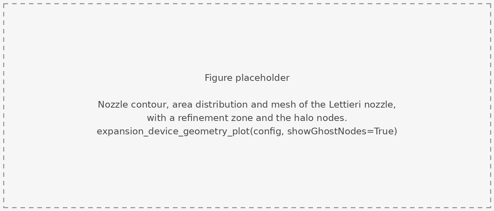

Configuration file
==================

All settings of a simulation are collected in a configuration file in the INI format: sections in square brackets, each followed by ``KEY = value`` lines. A complete example is given at the end of this page. The following conventions apply:

- Booleans must be written exactly as ``True`` or ``False``.
- Most string options are case insensitive, but the name of the property library must match the listed spelling.
- Units are SI.
- The parser does not flag unknown keys. A misspelled optional key is therefore silently ignored, and its default value is used.

Every input belongs to one of four classes: required (R), optional with the listed default (O), conditionally required (CR) or conditionally prohibited (CP). A conditionally required key must be present when another input has a certain value, and a conditionally prohibited key must then be absent, even if it would not be used. The rules are listed in :ref:`input-rules`. Before a simulation starts, the tool checks the configuration file against these rules, and stops with an explicit message if an input is missing, conflicting or outside its admissible range. Keys marked with R* have a default value in the code, but are read without default by the input checks, so they must be present.

[GEOMETRY]
----------

.. list-table::
   :header-rows: 1
   :widths: 30 8 22 40

   * - Key
     - Class
     - Values
     - Description
   * - ``EXPANSION_DEVICE_TYPE``
     - R
     - ``nozzle``, ``shocktube``
     - steady nozzle flow with early stopping, or transient shock tube
   * - ``DEVICE_TOPOLOGY``
     - R
     - ``planar``, ``axissymmetric``
     - cross-section: planar with a unit depth of 1 m, or circular. Note the spelling of ``axissymmetric``.
   * - ``DEVICE_GEOMETRY_FILE_PATH``
     - R
     - path
     - geometry file, see :ref:`geometry-file`

[MESH]
------

.. list-table::
   :header-rows: 1
   :widths: 30 8 22 40

   * - Key
     - Class
     - Values
     - Description
   * - ``NUM_MESH_NODES``
     - R
     - integer > 0
     - number of nodes, halo nodes excluded
   * - ``MESH_REFINEMENT_BOOL``
     - R*
     - ``True``, ``False``
     - refinement zone with a fixed number of uniformly spaced nodes
   * - ``X_START_REFINEMENT``, ``X_END_REFINEMENT``
     - CR, CP
     - float [m]
     - limits of the refinement zone
   * - ``NUM_REFINEMENT_MESH_NODES``
     - CR, CP
     - integer > 0
     - number of nodes in the refinement zone
   * - ``ADAPTIVE_MESH_REFINEMENT_BOOL``
     - R*
     - ``True``, ``False``
     - automated mesh refinement after convergence (nozzle only)
   * - ``RELATIVE_AMR_TOLERANCE``
     - CR, CP
     - float > 0
     - tolerance on the change between two successive meshes
   * - ``TOLERANCE_CALCULATION_METHOD``
     - CR, CP
     - ``vertical``, ``l2_norm``, ``normal``
     - measure of that change: maximum pointwise difference, L2 norm of the difference, or distance normal to the profile

[TIME]
------

.. list-table::
   :header-rows: 1
   :widths: 30 8 22 40

   * - Key
     - Class
     - Values
     - Description
   * - ``MAX_TIME``
     - R
     - float > 0 [s]
     - simulated time; for a nozzle only an upper bound, since the simulation stops once converged
   * - ``TIME_STEPPING_METHOD``
     - O
     - ``global`` (default), ``local``
     - all nodes advance with the smallest admissible time step, or every node with its own. Local time stepping accelerates the convergence to the steady state, but makes the transient meaningless.

[INITIAL CONDITIONS]
--------------------

For a shock tube, the section defines the states left and right of the interface:

.. list-table::
   :header-rows: 1
   :widths: 30 8 22 40

   * - Key
     - Class
     - Values
     - Description
   * - ``PRESSURE_LEFT``, ``PRESSURE_RIGHT``
     - R
     - float > 0 [Pa]
     - pressure left and right of the interface
   * - ``VELOCITY_LEFT``, ``VELOCITY_RIGHT``
     - R
     - float [m/s]
     - velocity left and right of the interface
   * - ``DENSITY_LEFT``, ``DENSITY_RIGHT``
     - CR
     - float > 0 [kg/m³]
     - either the densities or the temperatures, not both
   * - ``TEMPERATURE_LEFT``, ``TEMPERATURE_RIGHT``
     - CR
     - float > 0 [K]
     -

A nozzle with an inlet and an outlet, or an inlet and a transparent boundary, is initialized along the inlet isentrope with a linear pressure distribution, and needs no initial conditions. The section is then only used to enforce a uniform initial state instead:

.. list-table::
   :header-rows: 1
   :widths: 30 8 22 40

   * - Key
     - Class
     - Values
     - Description
   * - ``ENFORCE_UNIFORM_NOZZLE_INIT_BOOL``
     - O
     - ``True``, ``False`` (default)
     - uniform instead of linear isentropic initialization; required as ``True`` for any other pair of boundary conditions
   * - ``PRESSURE``, ``VELOCITY``
     - CR, CP
     - float [Pa], [m/s]
     - uniform initial state
   * - ``DENSITY`` or ``TEMPERATURE``
     - CR, CP
     - float > 0 [kg/m³] or [K]
     - exactly one of the two
   * - ``MASS_FLOW_DIRECTION``
     - CR, CP
     - ``1``, ``-1``
     - flow direction, if it cannot be inferred from the boundary conditions

[NUMERICS]
----------

.. list-table::
   :header-rows: 1
   :widths: 30 8 22 40

   * - Key
     - Class
     - Values
     - Description
   * - ``INTERCELL_FLUX_SCHEME``
     - R
     - ``godunov``, ``roe``, ``roe_arabi``, ``roe_vinokur``
     - numerical flux. Godunov and Roe for the ideal gas only, Roe-Arabi for real fluids only, Roe-Vinokur for both (:ref:`numerical-fluxes`)
   * - ``ENTROPY_FIX_ACTIVE_BOOL``
     - CR, CP
     - ``True``, ``False``
     - Harten-Hyman entropy fix
   * - ``ENTROPY_FIX_COEFFICIENT``
     - CR, CP
     - float > 0
     - coefficient of the entropy fix; 0.2 in the thesis cases
   * - ``MUSCL_RECONSTRUCTION_BOOL``
     - R*
     - ``True``, ``False``
     - second-order MUSCL reconstruction
   * - ``MUSCL_RECONSTRUCTION_FLUX_LIMITER``
     - CR
     - ``van_albada``, ``van_leer``, ``min_mod``, ``superbee``, ``none``
     - slope limiter
   * - ``CFL_MAX``
     - R
     - float > 0
     - CFL number; at most 0.9, or 0.8 with MUSCL
   * - ``WALL_FRICTION_MODELLING_BOOL``
     - R*
     - ``True``, ``False``
     - wall friction with the Haaland correlation
   * - ``DEVICE_SURFACE_ROUGHNESS``
     - CR, CP
     - float ≥ 0 [m]
     - wall roughness
   * - ``FLUID_VISCOSITY``
     - CR, CP
     - float > 0 [Pa s]
     - viscosity of an ideal gas, for the wall friction
   * - ``CONVERGENCE_TOLERANCE``
     - O
     - float > 0, default ``1e-5``
     - tolerance on the maximum relative change between two iterations (nozzle only)
   * - ``CONVERGENCE_PATIENCE``
     - O
     - integer > 0, default ``20``
     - number of consecutive iterations for which the tolerance must be met

[BOUNDARY CONDITIONS]
---------------------

.. list-table::
   :header-rows: 1
   :widths: 30 8 22 40

   * - Key
     - Class
     - Values
     - Description
   * - ``BOUNDARY_CONDITION_LEFT``, ``BOUNDARY_CONDITION_RIGHT``
     - R
     - ``inlet``, ``outlet``, ``transparent``, ``reflective``, ``periodic``
     - boundary conditions at the left and right end of the domain (:ref:`boundary-conditions`)
   * - ``INLET_CONDITIONS_TYPE``
     - CR, CP
     - ``total``, ``static``
     - total or static inlet conditions
   * - ``INLET_CONDITIONS_VALUES``
     - CR, CP
     - two floats, comma separated
     - total: :math:`p_0` [Pa] and :math:`T_0` [K] or :math:`y_V` [-]; static: :math:`p` [Pa] and :math:`T` [K] or :math:`y_V` [-]. A second value between 0 and 1 is read as a vapour quality, any other value as a temperature.
   * - ``OUTLET_CONDITIONS_VALUES``
     - CR, CP
     - float [Pa]
     - back pressure

[FLUID]
-------

.. list-table::
   :header-rows: 1
   :widths: 30 8 22 40

   * - Key
     - Class
     - Values
     - Description
   * - ``FLUID_NAME``
     - R
     - string
     - fluid name of the property library, e.g. ``CO2``, ``R1234ze(E)``, ``Air``
   * - ``FLUID_MODEL_TYPE``
     - R
     - ``ideal``, ``real``
     - ideal gas or real fluid
   * - ``FLUID_GAMMA``
     - CR, CP
     - float > 0
     - heat capacity ratio of the ideal gas
   * - ``GAS_R_CONSTANT``
     - CR, CP
     - float > 0 [J/(kg K)]
     - specific gas constant of the ideal gas
   * - ``FLUID_LIBRARY``
     - CR, CP
     - ``REFPROP``, ``HEOS``, ``CoolProp``; FluidProp: ``StanMix``, ``GasMix``, ``RefProp``, ``PCP-SAFT``, ``qPCP-SAFT``, ``HOGC-PCP-SAFT``; ``Humid Air``, ``Humid Air Mix``, ``LuT``, ``feos::HOGC-PCP-SAFT``
     - property library of the real fluid. Only ``REFPROP`` has been verified for two-phase flows.
   * - ``FLUID_PROPERTY_EXTRACTION_METHOD``
     - O
     - ``fluid``, ``abstractstate``, ``abstractstate_v2`` (default)
     - how the properties are requested: through the generic fluid object of the property interface, or through a wrapper around the low-level CoolProp ``AbstractState``, which accepts whole arrays

[OUTPUT]
--------

.. list-table::
   :header-rows: 1
   :widths: 30 8 22 40

   * - Key
     - Class
     - Values
     - Description
   * - ``RESULTS_SUBDIRECTORY_NAME``
     - R
     - string
     - results folder inside ``Results/``; may contain subfolders, e.g. ``lettieri/output_L1``
   * - ``WRITE_INTERVAL``
     - O
     - integer > 0, default ``250``
     - number of iterations between two saved steps
   * - ``PRINT_INFO_RESIDUALS_BOOL``
     - O
     - ``True`` (default), ``False``
     - residuals in the console, or only the progress in time
   * - ``OVERWRITE_RESULTS``
     - O
     - ``True``, ``False`` (default)
     - overwrite an existing results folder, or add a counter to the folder name

.. _input-rules:

Input rules
-----------

The input checks enforce the rules below. They are applied in the ``Config`` constructor, so that a faulty configuration file is detected before the pre-processing starts.

.. list-table::
   :header-rows: 1
   :widths: 30 35 35

   * - Condition
     - Requires
     - Prohibits
   * - ``MESH_REFINEMENT_BOOL``
     - ``True``: refinement limits and number of nodes
     - ``False``: refinement limits and number of nodes
   * - ``ADAPTIVE_MESH_REFINEMENT_BOOL``
     - ``True``: AMR tolerance and method
     - ``False``: AMR tolerance and method
   * - ``INTERCELL_FLUX_SCHEME``
     - Roe-type scheme: ``ENTROPY_FIX_ACTIVE_BOOL``; with the fix active also its coefficient
     - ``godunov``: both entropy-fix keys
   * - ``MUSCL_RECONSTRUCTION_BOOL = True``
     - flux limiter
     -
   * - ``WALL_FRICTION_MODELLING_BOOL``
     - ``True``: roughness; for an ideal gas also the viscosity
     - ``False``: roughness and viscosity
   * - ``FLUID_MODEL_TYPE``
     - ``ideal``: gamma and gas constant; ``real``: library
     - ``ideal``: library; ``real``: gamma and gas constant
   * - Inlet on either side
     - inlet type and values
     -
   * - Outlet on either side
     - outlet value
     -
   * - No inlet on either side
     -
     - inlet type and values
   * - Nozzle with the boundary pair inlet and outlet, or inlet and transparent, in either orientation
     -
     - ``MASS_FLOW_DIRECTION``, which is inferred
   * - Nozzle with any other boundary pair
     - ``ENFORCE_UNIFORM_NOZZLE_INIT_BOOL = True``, uniform initial state and ``MASS_FLOW_DIRECTION``
     -
   * - ``ENFORCE_UNIFORM_NOZZLE_INIT_BOOL``
     - ``True``: ``PRESSURE``, ``VELOCITY``, and ``DENSITY`` or ``TEMPERATURE``
     - ``False``: ``PRESSURE``, ``VELOCITY``, ``DENSITY``, ``TEMPERATURE``
   * - Shock tube
     - left and right pressure and velocity; densities or temperatures
     - densities and temperatures together

.. _geometry-file:

Geometry file
-------------

The geometry file is a comma-separated file with a header line and two columns. The first column holds the axial coordinate :math:`x` [m]. The second column, named ``y`` or ``A``, holds either the half-height (planar) or radius (axisymmetric) [m], or the cross-sectional area [m²]; the header tells the tool which of the two is given. The rows are sorted by :math:`x` on reading, and the domain spans the first to the last value of :math:`x`. When mesh refinement is used, :math:`x` must start at zero, since the refinement limits are measured from the origin. The geometry file of the nozzle of Lettieri et al., for example, starts as follows:

.. code-block:: text

   x,y
   0.00000,0.00638
   0.00413,0.00601
   0.00778,0.00513
   ...

A shock-tube file contains three rows: the left end, the position of the interface and the right end, with a constant ``y`` or ``A``:

.. code-block:: text

   x,A
   0,1
   0.5,1
   1.0,1

From the geometry, the tool computes the area, its derivative and the wetted perimeter at the mesh nodes, and adds one halo node beyond each end of the domain, in which the boundary conditions are imposed (:numref:`fig-discretization`). The script ``plot_nozzle_geometry.py`` in ``numerical_experiments/nozzle_steady_two_phase/`` plots the geometry and the mesh before a simulation is started (:numref:`fig-geometry-mesh`).

.. _fig-geometry-mesh:

   Nozzle contour, area distribution and mesh of the nozzle of Lettieri et al., with a refinement zone and the halo nodes.

.. this figure is a placeholder: replace placeholder_geometry_mesh.png by the output of expansion_device_geometry_plot

Example
-------

The configuration below simulates the condensing CO2 expansion of case L1 of Lettieri et al. with wall friction. The planar nozzle has a total inlet at the left, with :math:`p_0 = 5.896` MPa and :math:`T_0 = 314.7` K, and a transparent outlet at the right. The flow is therefore initialized along the inlet isentrope, and the flow direction is inferred, so that the section ``[INITIAL CONDITIONS]`` only contains the default value.

.. code-block:: ini

   [GEOMETRY]
   EXPANSION_DEVICE_TYPE = nozzle
   DEVICE_TOPOLOGY = planar
   DEVICE_GEOMETRY_FILE_PATH = inputs/nozzle_geometries/nozzle_lettieri.csv

   [MESH]
   NUM_MESH_NODES = 200
   MESH_REFINEMENT_BOOL = False
   ADAPTIVE_MESH_REFINEMENT_BOOL = False

   [TIME]
   MAX_TIME = 0.05
   TIME_STEPPING_METHOD = global

   [INITIAL CONDITIONS]
   ENFORCE_UNIFORM_NOZZLE_INIT_BOOL = False

   [NUMERICS]
   INTERCELL_FLUX_SCHEME = roe_arabi
   ENTROPY_FIX_ACTIVE_BOOL = True
   ENTROPY_FIX_COEFFICIENT = 0.2
   MUSCL_RECONSTRUCTION_BOOL = False
   CFL_MAX = 0.5
   WALL_FRICTION_MODELLING_BOOL = True
   DEVICE_SURFACE_ROUGHNESS = 0.0
   CONVERGENCE_TOLERANCE = 1e-5
   CONVERGENCE_PATIENCE = 20

   [BOUNDARY CONDITIONS]
   BOUNDARY_CONDITION_LEFT = inlet
   BOUNDARY_CONDITION_RIGHT = transparent
   INLET_CONDITIONS_TYPE = total
   INLET_CONDITIONS_VALUES = 5896000, 314.7

   [FLUID]
   FLUID_NAME = CO2
   FLUID_MODEL_TYPE = real
   FLUID_LIBRARY = REFPROP
   FLUID_PROPERTY_EXTRACTION_METHOD = AbstractState_v2

   [OUTPUT]
   RESULTS_SUBDIRECTORY_NAME = lettieri/output_L1_friction
   WRITE_INTERVAL = 250
   PRINT_INFO_RESIDUALS_BOOL = True
   OVERWRITE_RESULTS = False
