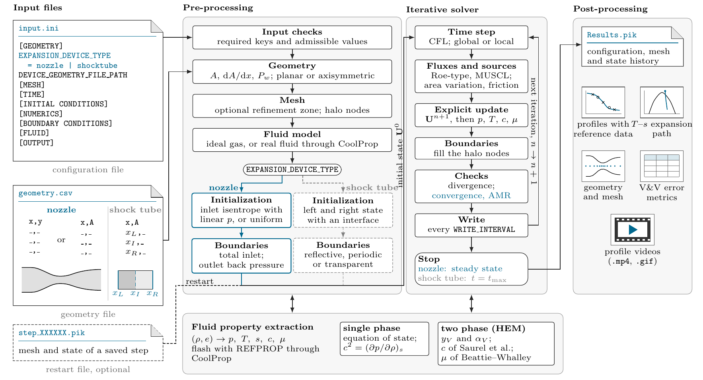

PyShockFlow
===========

PyShockFlow solves the quasi-1D Euler equations for the flow of an ideal gas or a real fluid through a duct of varying cross-section. The code was originally developed in the Propulsion & Power group of TU Delft to study shock tubes, and was extended in the MSc thesis *Towards Turbine-Induced Expansion in High-Temperature Heat Pumps* to the steady flow through converging-diverging nozzles, including flashing and condensing two-phase flows. In the two-phase region, the equations are closed by the homogeneous equilibrium model (HEM), and all thermophysical properties are obtained from NIST REFPROP through CoolProp.

For a given nozzle geometry and given inlet and outlet conditions, the tool predicts the steady distribution of the pressure, density, velocity, temperature and Mach number along the nozzle, and with it the expansion path of the fluid. It was written with three requirements in mind:

1. it must be modular, so that higher-fidelity models, such as non-equilibrium phase change, can be added later;
2. it must be usable over the entire liquid-vapour region, i.e. for liquid, vapour, supercritical and two-phase states, and for the transitions between them;
3. it must be fast enough for preliminary design, in which many geometries and operating points are evaluated.

The structure of the tool is shown in :numref:`fig-block-diagram`. A simulation is defined by a configuration file and a geometry file. Pre-processing checks the inputs, builds the mesh and initializes the flow field, the iterative solver marches the solution in time until it no longer changes, and post-processing turns the stored results into figures. The setting ``EXPANSION_DEVICE_TYPE`` decides whether a nozzle or a shock tube is simulated. The two branches differ in the initialization, the boundary conditions and the stopping criterion, but share the solver and the post-processing.

.. _fig-block-diagram:

   Architecture of the tool. The nozzle branch is drawn in navy, the shock-tube branch in grey. Both the pre-processing and the solver call the fluid property extraction.

The table below summarizes what can be selected in the configuration file.

.. list-table::
   :header-rows: 1
   :widths: 25 75

   * - Feature
     - Options
   * - Device
     - nozzle (steady state, early stopping) or shock tube (transient)
   * - Topology
     - planar (unit depth) or axisymmetric
   * - Fluid model
     - ideal gas, or real fluid from REFPROP or CoolProp (HEOS), FluidProp, look-up tables or FeOs
   * - Thermodynamic region
     - liquid, vapour, supercritical and two-phase (HEM) states
   * - Inlet
     - total :math:`(p_0, T_0)` or :math:`(p_0, y_V)`
   * - Outlet
     - back pressure, with an automatic switch to a transparent boundary once the outflow is supersonic
   * - Other boundaries
     - transparent, reflective, periodic
   * - Wall friction
     - Haaland correlation with wall roughness; Beattie-Whalley viscosity in the two-phase region
   * - Mesh
     - uniform, or with a refinement zone; automated mesh refinement
   * - Numerical flux
     - Godunov, Roe, Roe-Arabi, Roe-Vinokur; Harten-Hyman entropy fix
   * - Reconstruction
     - first order, or MUSCL with the van Albada, van Leer, minmod or superbee limiter
   * - Time stepping
     - global or local; early stopping with a tolerance and a patience
   * - Output
     - restart files, results file, profiles, T-s expansion paths, error metrics against reference data, videos

New users are advised to read :doc:`installation` and :doc:`running` first, and to start from one of the example cases. :doc:`configuration` is the reference of all inputs, and :doc:`model` explains what the tool computes with them.

.. toctree::
   :maxdepth: 1
   :caption: Contents

   installation
   running
   configuration
   model
   post_processing
   api

Background and authors
----------------------

PyShockFlow was written by Francesco Neri and Matteo Pini (TU Delft). The nozzle and two-phase extensions, the input checks, the convergence and mesh refinement options and the post-processing described here were added by Matthias Van Mechelen. The modelling choices are discussed in detail in Chapter 4 of the thesis, and the verification and validation of the tool in Chapter 5. The implementation of the HEM follows the quasi-1D model of Cioffi et al. [Cioffi2025]_.
