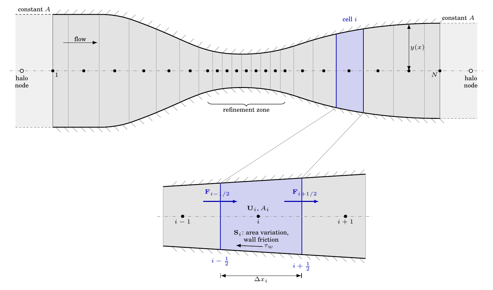

Model and numerics
==================

This page summarizes what the tool computes, as far as it is needed to choose the inputs and to interpret the results. The modelling choices are discussed in detail in Chapter 4 of the thesis.

Governing equations
-------------------

The tool solves the quasi-1D Euler equations for the conservative variables per unit volume, with the area variation and the wall friction as source terms:

.. math::

   \frac{\partial \mathbf{U}}{\partial t} + \frac{\partial \mathbf{F}}{\partial x} = \mathbf{S}, \qquad
   \mathbf{U} = \begin{bmatrix} \rho \\ \rho u \\ \rho e_0 \end{bmatrix}, \qquad
   \mathbf{F} = \begin{bmatrix} \rho u \\ \rho u^2 + p \\ \rho u h_0 \end{bmatrix}, \qquad
   \mathbf{S} = -\frac{1}{A}\frac{\mathrm{d}A}{\mathrm{d}x}\begin{bmatrix} \rho u \\ \rho u^2 \\ \rho u h_0 \end{bmatrix}
   - \begin{bmatrix} 0 \\ \tau_w P_w / A \\ 0 \end{bmatrix}

The flux is therefore that of the 1D Euler equations, and the Riemann solvers developed for them apply without modification. The walls are adiabatic. In the two-phase region, the equations are closed by the homogeneous equilibrium model (HEM): both phases have the same velocity, pressure, temperature and chemical potential, so that the mixture behaves as a single fluid with a particular equation of state. Vapour appears exactly at the saturation line, and metastable states are not represented.

Fluid properties
----------------

The conservative variables give the density :math:`\rho` and, after subtraction of the kinetic energy, the specific internal energy :math:`e` in every node. All other properties follow from an isochoric-isoenergetic flash in :math:`(\rho, e)`, which is performed by REFPROP through CoolProp. For a two-phase state, the flash returns the saturated liquid and vapour at the local temperature and the vapour quality :math:`y_V`; the void fraction then follows as :math:`\alpha_V = y_V \rho / \rho_V`. The integration tests compare this flash with an independent solution of the equilibrium conditions formulated by Giljarhus et al. [Giljarhus2012]_.

In the two-phase region, the speed of sound is a property of the model rather than of the fluid. The tool uses the equilibrium speed of sound of Saurel et al. [Saurel2008]_,

.. math::

   \frac{1}{\rho c^2} =
   \frac{\alpha_L}{\rho_L c_L^2} + \frac{\alpha_V}{\rho_V c_V^2}
   + T\left[\frac{\alpha_L \rho_L}{c_{p,L}}\left(\frac{\mathrm{d}s_L}{\mathrm{d}p}\right)_{\mathrm{sat}}^{2}
   + \frac{\alpha_V \rho_V}{c_{p,V}}\left(\frac{\mathrm{d}s_V}{\mathrm{d}p}\right)_{\mathrm{sat}}^{2}\right],

with the derivatives along the saturation curves evaluated by central differences with a pressure step of 1 kPa. This speed of sound drops discontinuously when the state crosses a saturation line, which is the most frequent source of numerical difficulties. The viscosity of the mixture, needed for the wall friction, follows from the correlation of Beattie and Whalley, :math:`\mu = \alpha_V \mu_V + (1 - \alpha_V)(1 + 2.5\,\alpha_V)\,\mu_L`.

Inside the saturation dome, pressure and temperature are not independent, and a flash in :math:`(p, T)` returns the saturated liquid rather than the mixture. A two-phase inlet must therefore be specified with a vapour quality instead of a temperature.

Discretization
--------------

The domain is divided into control volumes around the mesh nodes, bounded by interfaces halfway between neighbouring nodes (:numref:`fig-discretization`). One halo node is added beyond each end of the domain, at a distance equal to the adjacent node spacing; the boundary conditions are imposed in these nodes, and the area is kept constant there. Optionally, a refinement zone with a fixed number of uniformly spaced nodes is placed, for instance, around the throat. Outside this zone, the spacing grows linearly towards that of the uniform mesh.

.. _fig-discretization:

   Quasi-1D finite-volume discretization of a planar nozzle, with the mesh refined around the throat and the halo nodes at both ends. Bottom: the control volume of node :math:`i`.

The planar topology assumes a unit depth of 1 m, so that :math:`A = 2y` and :math:`P_w = 2(2y) + 2`; the axisymmetric topology gives :math:`A = \pi y^2` and :math:`P_w = 2\pi y`. The conservative variables are advanced with the explicit Euler method,

.. math::

   \mathbf{U}_i^{n+1} = \mathbf{U}_i^{n} + \frac{\Delta t_i}{\Delta x_i}\left(\mathbf{F}_{i-1/2}^{n} - \mathbf{F}_{i+1/2}^{n}\right) + \Delta t_i\, \mathbf{S}_i^{n},

where the time step follows from the CFL condition, :math:`\Delta t_i = \mathrm{CFL}\,\Delta x_i / (|u_i| + c_i)`. With global time stepping, all nodes advance with the smallest :math:`\Delta t_i`; with local time stepping, every node advances with its own.

.. _numerical-fluxes:

Numerical fluxes
----------------

.. list-table::
   :header-rows: 1
   :widths: 25 45 30

   * - Scheme
     - Principle
     - Fluid models
   * - ``godunov``
     - exact Riemann solver
     - ideal gas
   * - ``roe``
     - Roe's approximate Riemann solver
     - ideal gas
   * - ``roe_arabi``
     - Roe averages with an averaged speed of sound, after Arabi et al. [Arabi2017]_; requires no derivatives of the equation of state
     - real fluid, including the HEM
   * - ``roe_vinokur``
     - averaged pressure derivatives that satisfy the Roe property, after Vinokur and Montagné [Vinokur1990]_
     - ideal gas and real fluid, including the HEM

The Roe-Arabi scheme was used for the two-phase cases of the thesis, since the derivatives of the equilibrium equation of state are discontinuous at the saturation line. The Roe-type schemes optionally apply the entropy fix of Harten and Hyman, which prevents non-physical expansion shocks at a sonic throat. Second-order accuracy in space is obtained with MUSCL reconstruction of the primitive variables, which is not yet robust for all two-phase cases.

Initialization
--------------

A nozzle with an inlet and an outlet, or an inlet and a transparent boundary, is initialized after Cioffi et al. [Cioffi2025]_: the static pressure varies linearly between the inlet and the outlet, and every node receives the state on the inlet isentrope at its pressure. For a transparent outlet, one fifth of the inlet pressure is used as outlet pressure. If the inlet isentrope gives no valid state at that pressure, the tool finds the lowest valid outlet pressure by bisection and reports this with a warning. For other boundary conditions, or when ``ENFORCE_UNIFORM_NOZZLE_INIT_BOOL`` is ``True``, the domain is initialized with a uniform state. A shock tube is initialized with a left and a right state, separated by the interface given in the geometry file.

.. _boundary-conditions:

Boundary conditions
-------------------

The boundary conditions are imposed in the halo nodes, following [Toro2009]_. Their number and nature follow from the characteristics of the Euler equations: a subsonic inlet requires two physical conditions, a subsonic outlet one, and a supersonic outlet none.

.. list-table::
   :header-rows: 1
   :widths: 30 30 40

   * - Boundary condition
     - Imposed
     - Taken from the interior
   * - inlet, total :math:`(p_0, T_0)`
     - total enthalpy and entropy
     - velocity
   * - inlet, total :math:`(p_0, y_V)`
     - total pressure and static quality
     - velocity
   * - outlet, subsonic
     - back pressure
     - density and velocity
   * - outlet, supersonic
     - none
     - all (transparent)
   * - transparent
     - none
     - all, zero gradient
   * - reflective
     - zero mass flux
     - density, pressure and energy; velocity mirrored
   * - periodic
     - none
     - state of the opposite boundary

An outlet switches automatically to a transparent boundary once the Mach number of the adjacent interior node exceeds one. Since the HEM speed of sound is that of the solved system, this switch is consistent with the model in the two-phase region.

Wall friction
-------------

The wall shear stress follows from the Darcy friction factor :math:`f`, evaluated with the correlation of Haaland,

.. math::

   \tau_w = \frac{f}{8}\,\rho u^2, \qquad
   \frac{1}{\sqrt{f}} = -1.81\,\log_{10}\left[\frac{6.9}{\mathrm{Re}} + \left(\frac{\varepsilon/D}{3.7}\right)^{1.11}\right], \qquad
   \mathrm{Re} = \frac{\rho |u| D}{\mu},

with :math:`D = 2y` and :math:`\varepsilon` the wall roughness. In the two-phase region, :math:`\mu` is the Beattie-Whalley viscosity, so that the friction relies on a single-phase correlation with a mixture viscosity.

Convergence and mesh refinement
-------------------------------

A nozzle simulation counts an iteration as converged if

.. math::

   \max_i \frac{|q_i^{n+1} - q_i^{n}|}{\max_i |q_i^{n}|} < \epsilon_{\mathrm{tol}} \qquad \text{for } q \in \{\rho, u, p, e\},

and stops once this holds for :math:`N_p` consecutive iterations (``CONVERGENCE_TOLERANCE`` and ``CONVERGENCE_PATIENCE``). The maximum norm does not let a large local change be averaged out over the domain, and the patience prevents a stop during a momentary stagnation of the transient.

With the automated mesh refinement, the number of nodes is doubled after every converged solution, the converged density, velocity and pressure are interpolated onto the new mesh, and the time marching restarts. Since the first converged solution has no coarser counterpart, the mesh is refined at least once. The refinement ends when the solutions on two successive meshes differ by less than ``RELATIVE_AMR_TOLERANCE``. Despite its name, the option refines the entire mesh rather than local regions.

Limitations
-----------

- Equilibrium only: metastable liquid, delayed flashing and finite-rate phase change are not resolved, so the critical mass flux of short nozzles with subcooled or low-quality inlets is under-predicted.
- Quasi-1D: boundary layers, oblique shocks and lateral phase separation are absent. Planar nozzles are treated with unit depth, which underestimates the friction on the side walls of narrow test sections.
- The discontinuous HEM speed of sound can destabilize the Roe-type schemes at low vapour fractions.
- The explicit scheme is limited by the CFL condition, and the iterative :math:`(\rho, e)` flash dominates the run time of a two-phase simulation.

References
----------

.. [Giljarhus2012] K. E. T. Giljarhus, S. T. Munkejord and G. Skaugen, "Solution of the Span-Wagner equation of state using a density-energy state function for fluid-dynamic simulation of carbon dioxide", *Industrial & Engineering Chemistry Research* 51(2), 1006-1014, 2012.
.. [Saurel2008] R. Saurel, F. Petitpas and R. Abgrall, "Modelling phase transition in metastable liquids: application to cavitating and flashing flows", *Journal of Fluid Mechanics* 607, 313-350, 2008.
.. [Arabi2017] S. Arabi, J.-Y. Trépanier and R. Camarero, "A simple extension of Roe's scheme for real gases", *Journal of Computational Physics* 329, 16-28, 2017.
.. [Vinokur1990] M. Vinokur and J.-L. Montagné, "Generalized flux-vector splitting and Roe average for an equilibrium real gas", *Journal of Computational Physics* 89(2), 276-300, 1990.

.. [Cioffi2025] A. Cioffi, A. Bergamin, R. Agromayor and F. Haglind, "A hyperbolic one-dimensional model for two-phase flows in converging-diverging nozzles", *Journal of Turbomachinery* 148(3), 031017, 2026.
.. [Toro2009] E. F. Toro, *Riemann Solvers and Numerical Methods for Fluid Dynamics*, 3rd ed., Springer, 2009.
