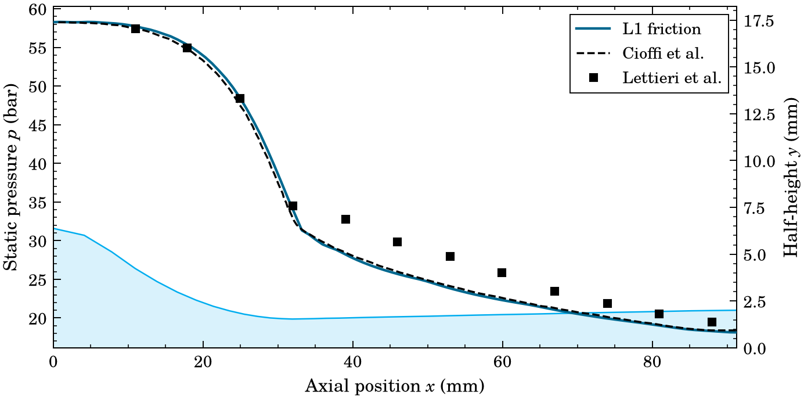
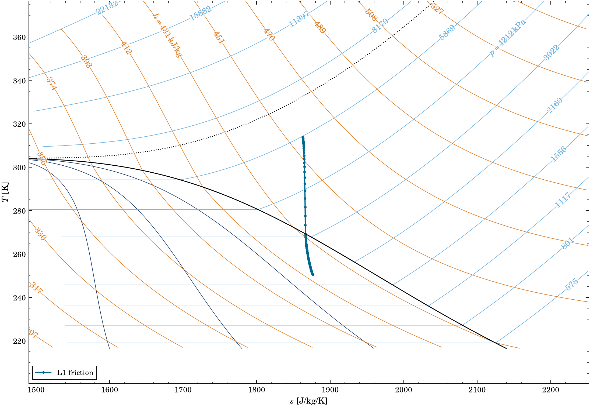

Post-processing
===============

Running the solver and post-processing its results are separated. The results file contains everything needed to regenerate a figure, so that a simulation never has to be repeated for a different plot. The functions below are imported from ``pyshockflow.post_processing``, and ``numerical_experiments/nozzle_steady_two_phase/postprocess.py`` shows their use for the cases of the thesis.

Results file
------------

``Results.pik`` is a pickled dictionary with the keys ``config``, ``deviceGeometryData``, ``meshData``, ``iterIdxHistory``, ``timeHistory`` and ``fluidStateHistory`` (:numref:`fig-output-files`). The latter maps every fluid state variable, such as ``Density``, ``Velocity``, ``Pressure`` and ``staticInternalEnergy``, to an array with one row per mesh node and one column per saved step. The data can therefore also be read directly:

.. code-block:: python

   import pickle

   with open("Results/lettieri/output_L1_smooth/Results.pik", "rb") as file:
       results = pickle.load(file)

   x = results["meshData"]["xMeshNodes"]
   p = results["fluidStateHistory"]["Pressure"][:, -1]   # last saved step

The first and last entries of every array belong to the halo nodes.

Functions
---------

All functions take a list of results folders, so that several simulations can be compared in one figure, provided that they share the nozzle geometry or, for the T-s diagram, the working fluid. An iteration index of ``-1`` selects the last saved step.

.. list-table::
   :header-rows: 1
   :widths: 38 62

   * - Function
     - Output
   * - ``expansion_device_geometry_plot``
     - nozzle contour and mesh nodes, optionally with the halo nodes; from a configuration file, before the simulation, or from a results folder
   * - ``generate_fluid_state_var_profile_figs``
     - profiles of ``Density``, ``Pressure``, ``Velocity``, ``internalEnergy``, ``Mach``, ``Entropy`` or ``Temperature`` at selected iterations, optionally with reference data, the nozzle contour and the mesh nodes
   * - ``compute_v_and_v_metrics``
     - absolute and relative errors at the points of the reference data, returned as a dictionary; their maxima are printed as a table
   * - ``generate_expansion_thermoplot``
     - expansion paths in a T-s diagram, drawn with Thermoplot
   * - ``render_profile_video``
     - video of the evolution of a profile during the time marching, optionally with the unconverged nodes highlighted

By default, ``generate_fluid_state_var_profile_figs`` saves every figure as a PDF file in ``Figures/``, in a folder named after the configuration file of the case, e.g. ``Figures/lettieri/L1_friction/Pressure__iter_2500.pdf``; a figure that compares several cases goes to a ``compare__`` folder. The default figure width equals the text width of the thesis, so that the fonts appear at their true size when a figure is included at its own width; ``figureSize`` and ``fontSize`` adapt this. ``use_plot_style`` gives other figures the same style.

Reference data
--------------

Verification and validation data are passed as ``VandVSpec`` objects. A ``VandVSpec`` maps the name of a fluid state variable to one or more CSV files, each with the header ``deviceX,<variable>``, and optionally to legend labels. In the figures, verification data are drawn as dashed lines and validation data as markers. The file with the verification data of case L1, for example, starts as follows:

.. code-block:: text

   deviceX,Pressure
   0.000509419,5824421.96
   0.001583403,5824421.96
   ...

The example below plots the pressure and Mach number of case L1 with wall friction against the results of Cioffi et al. and the measurements of Lettieri et al., computes the errors, and draws the expansion path:

.. code-block:: python

   import matplotlib.pyplot as plt
   from pyshockflow.post_processing import (
       VandVSpec,
       generate_fluid_state_var_profile_figs,
       compute_v_and_v_metrics,
       generate_expansion_thermoplot,
   )

   verificationData = VandVSpec(
       paths={"Pressure": "verification_data/lettieri/L1_friction__pressure.csv"},
       legend_labels={"Pressure": "Cioffi et al."},
   )
   validationData = VandVSpec(
       paths={"Pressure": "validation_data/lettieri/L1_friction__pressure.csv"},
       legend_labels={"Pressure": "Lettieri et al."},
   )

   generate_fluid_state_var_profile_figs(
       resultsFolders=["Results/lettieri/output_L1_friction"],
       fluidStateVarNames=["Pressure", "Mach"],
       iterationIndexes=[-1],
       simulationLegendLabels=["L1 friction"],
       verificationData=verificationData,
       validationData=validationData,
       showNozzleGeometry=True,
   )

   compute_v_and_v_metrics(
       resultsFolders=["Results/lettieri/output_L1_friction"],
       fluidStateVarNames=["Pressure"],
       verificationData=verificationData,
   )

   generate_expansion_thermoplot(
       resultsFolders=["Results/lettieri/output_L1_friction"],
       iterationIndexes=[-1],
       simulationLegendLabels=["L1 friction"],
       thermoplotConfigFilePath="inputs/thermoplot/CO2.ini",
   )
   plt.show()

.. _fig-profiles:

   Pressure profile of case L1 of Lettieri et al., as plotted by the example above, with the results of Cioffi et al. (verification), the measurements of Lettieri et al. (validation) and the nozzle contour.

The background of the T-s diagram, i.e. the fluid, the region of interest and the isolines, is set in a Thermoplot configuration file, of which examples are found in ``numerical_experiments/nozzle_steady_two_phase/inputs/thermoplot/``.

.. _fig-expansion-path:

   Expansion path of case L1 of Lettieri et al. in the T-s diagram, as plotted by the example above.

Videos
------

``render_profile_video`` writes a video of one variable to the results folder, as an MP4 file if FFmpeg is available and as a GIF file otherwise. Since every saved step becomes a frame, ``WRITE_INTERVAL`` determines the resolution in time. With ``show_unconverged_nodes=True``, the nodes that do not yet meet the convergence tolerance are highlighted, which helps to find the region that delays the convergence.

.. code-block:: python

   from pyshockflow.post_processing import render_profile_video

   render_profile_video(
       results_folder="Results/lettieri/output_L1_smooth",
       fluid_state_var_name="Pressure",
       output_path="pressure.mp4",
       show_unconverged_nodes=True,
   )
