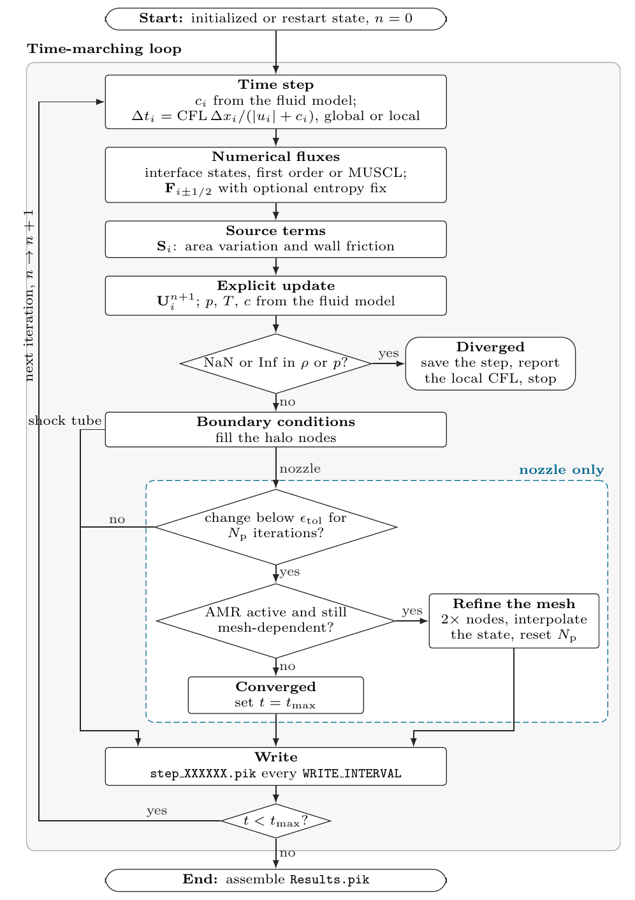
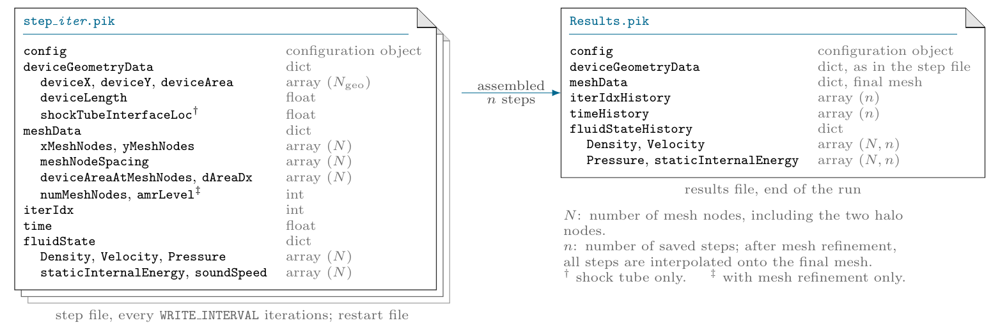

Running a simulation
====================

Workflow
--------

A nozzle simulation consists of five steps:

1. **Geometry.** Export the nozzle contour to a geometry file, with :math:`x` and :math:`y(x)` or :math:`A(x)` (:ref:`geometry-file`).
2. **Configuration.** Write the configuration file (:doc:`configuration`). It is easiest to start from the file of a similar case.
3. **Run.** Create a ``Config`` and a ``Driver`` object and call ``solve()``, as shown below.
4. **Monitor.** Follow the residuals in the console, and restart from a saved step if necessary.
5. **Post-process.** Plot the profiles and expansion paths, and compare them with reference data (:doc:`post_processing`).

A simulation is run from a short Python script, such as ``main.py`` in the folders of the example cases:

.. code-block:: python

   from pyshockflow import Config, Driver

   config = Config(configFilePath="inputs/config_files/lettieri/L1_smooth.ini")
   driver = Driver(config=config)
   driver.solve()

Creating the ``Config`` object reads the configuration file and performs the input checks. The ``Driver`` performs the pre-processing, i.e. it reads the geometry, generates the mesh, creates the fluid model, initializes the flow field and imposes the boundary conditions. ``solve()`` then runs the iterative solver. The script must be executed in the folder that contains the input files, since the paths in the configuration file, and the ``Results`` folder, are relative to the working directory.

The solver
----------

:numref:`fig-solver-loop` shows the operations of one iteration in the order of the implementation. Every iteration computes the speed of sound and the time step, the numerical fluxes and the source terms, and updates the conservative variables. The new state is checked for non-numerical values, after which the boundary conditions fill the halo nodes. For a nozzle, the solver then checks whether the solution has converged and, if the automated mesh refinement is active, whether it still depends on the mesh. A shock tube skips these checks and runs until ``MAX_TIME``.

.. _fig-solver-loop:

   Solution procedure of the iterative solver. The convergence check and the automated mesh refinement (AMR) apply to nozzle simulations only.

A nozzle simulation stops once the maximum relative change of the density, velocity, pressure and internal energy between two iterations stays below ``CONVERGENCE_TOLERANCE`` for ``CONVERGENCE_PATIENCE`` consecutive iterations. ``MAX_TIME`` is then only an upper bound: if it is reached first, the tool stops with a warning that the solution has not converged. With the automated mesh refinement, the number of nodes is doubled after every converged solution, until the solutions on two successive meshes differ by less than ``RELATIVE_AMR_TOLERANCE``.

Console output and results
--------------------------

The console first summarizes the fluid, the boundary conditions and the numerical settings. If ``PRINT_INFO_RESIDUALS_BOOL`` is ``True``, every iteration prints a line such as

.. code-block:: text

   Iteration 555    Progress in Time 21.882%    Residuals: -6.543797, -3.821169, -1.716681

where the residuals are the base-10 logarithm of the norm of the residual of the mass, momentum and energy equation, divided by the number of nodes. Note that these residuals are not the quantity on which the convergence check acts. The refinement steps of the automated mesh refinement and the warnings are printed as well.

The results are written to ``Results/<RESULTS_SUBDIRECTORY_NAME>``. During the run, the state in all nodes is saved every ``WRITE_INTERVAL`` iterations to a file ``step_XXXXXX.pik``, with ``XXXXXX`` the iteration number. At the end of the run, these files are assembled into a single file ``Results.pik``, which contains the configuration, the mesh and the history of all saved steps, and the individual step files are removed. If the results folder already exists and ``OVERWRITE_RESULTS`` is ``False``, a counter is added to the folder name, e.g. ``output_L1_smooth_1``. Both files are pickled Python dictionaries, of which :numref:`fig-output-files` shows the contents.

.. _fig-output-files:

   Contents of the step and results files. Indented keys belong to the nested dictionary above them.

Restarting a simulation
-----------------------

A simulation can be continued from a saved step by passing a restart file to the ``Driver``:

.. code-block:: python

   driver = Driver(config=config,
                   restartFilePath="Results/lettieri/output_L1_smooth/step_002000.pik")
   driver.solve()

The restart path can be a step file, a results folder or a ``Results.pik`` file. In the latter two cases, the tool lists the available iterations and asks which one to restart from. The mesh, the fluid state, the time and the level of the automated mesh refinement are taken from the restart file, whereas all other settings are taken from ``config``. This makes it possible to continue a simulation with, for instance, a larger ``MAX_TIME`` or a lower ``CFL_MAX``. With ``config=None``, the configuration stored in the restart file is used. New steps are written to the folder of the restart file. When restarting from ``Results.pik``, the steps up to the selected iteration are unpacked into step files, and ``Results.pik`` is replaced at the end of the new run.

.. _example-cases:

Example cases
-------------

The regression tests in ``test/regression_tests/`` are the smallest complete examples, each with a configuration file, a geometry file and a ``main.py``:

.. list-table::
   :header-rows: 1
   :widths: 25 75

   * - Case
     - Description
   * - ``sod_test_godunov``, ``sod_test_roe``
     - Sod shock tube with an ideal gas, with the Godunov and Roe schemes
   * - ``nonideal_CO2``
     - shock tube with CO2 near the critical point, after D'Alessandro et al., with the HEOS backend of CoolProp
   * - ``nozzle_steady``
     - converging-diverging nozzle with air, total inlet and back pressure outlet
   * - ``mesh_refinement``
     - Sod shock tube with a refinement zone, which must give the same result as a uniform mesh
   * - ``thruster``
     - nozzle with a closed (reflective) left end and an outlet, initialized with a uniform state

The two-phase cases of the thesis are in ``numerical_experiments/nozzle_steady_two_phase/``. The folder contains the configuration files of the nozzles of Lettieri et al., Petruccelli et al., Berana et al., Nakagawa et al., Zhu and Elbel, the Moby Dick nozzle and the ORCHID nozzle, the corresponding geometry files, and verification and validation data. ``main.py`` runs one case, ``postprocess.py`` makes the figures, and ``plot_nozzle_geometry.py`` plots the geometry and the mesh before a simulation is started. The other folders in ``numerical_experiments/`` contain older investigations of the original PyShockFlow, such as the shock-tube problems of Toro, and still use the input format of that version; their configuration files must be updated before they run.

For a new two-phase nozzle simulation, the settings of the thesis cases are a good starting point: REFPROP with ``FLUID_PROPERTY_EXTRACTION_METHOD = AbstractState_v2``, the Roe-Arabi scheme with the entropy fix (coefficient 0.2), first-order reconstruction, a CFL number between 0.5 and 0.9, and between 200 and 1600 mesh nodes, or 200 nodes with the automated mesh refinement.

Troubleshooting
---------------

.. list-table::
   :header-rows: 1
   :widths: 28 34 38

   * - Symptom
     - Likely cause
     - Remedy
   * - Error on a missing or prohibited key
     - the configuration violates one of the rules of :ref:`input-rules`
     - add or remove the key named in the message
   * - Error on a missing ``ADAPTIVE_MESH_REFINEMENT_BOOL``
     - configuration file written for an older version
     - add the key, with ``False`` to switch the refinement off
   * - Warning on a non-numerical density during the initialization
     - the outlet pressure guess lies outside the range of the inlet isentrope
     - none needed, the tool raises the outlet pressure by bisection; check the outlet conditions
   * - Simulation stops with non-numerical values and reports a CFL number
     - instability, often at the saturation line or at the start of the run
     - lower ``CFL_MAX``, activate the entropy fix, switch MUSCL off, refine the mesh, check the boundary conditions
   * - Maximum time reached without convergence
     - slow transient or oscillating solution
     - increase ``MAX_TIME``, use local time stepping, inspect the unconverged nodes in the profile figures
   * - Two-phase inlet gives a saturated liquid state
     - inlet specified with :math:`(p_0, T_0)` inside the saturation dome
     - specify the inlet with :math:`(p_0, y_V)`
   * - A setting has no effect
     - misspelled optional key, which is silently ignored
     - check the spelling against :doc:`configuration`
